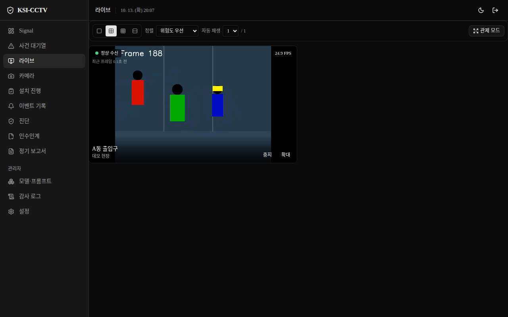
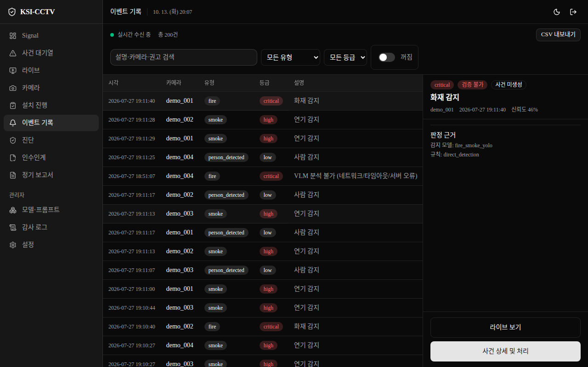
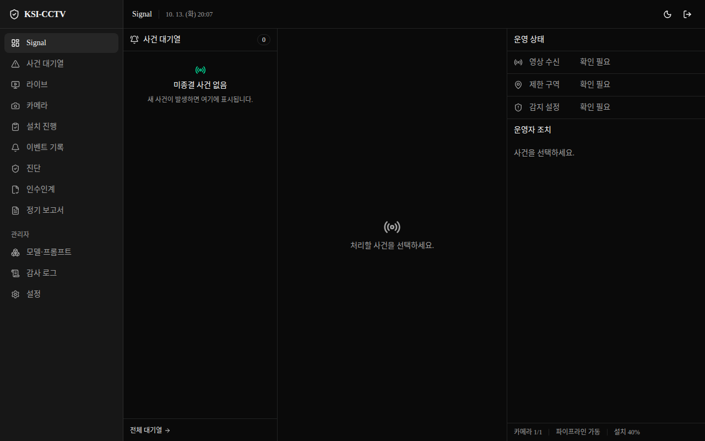
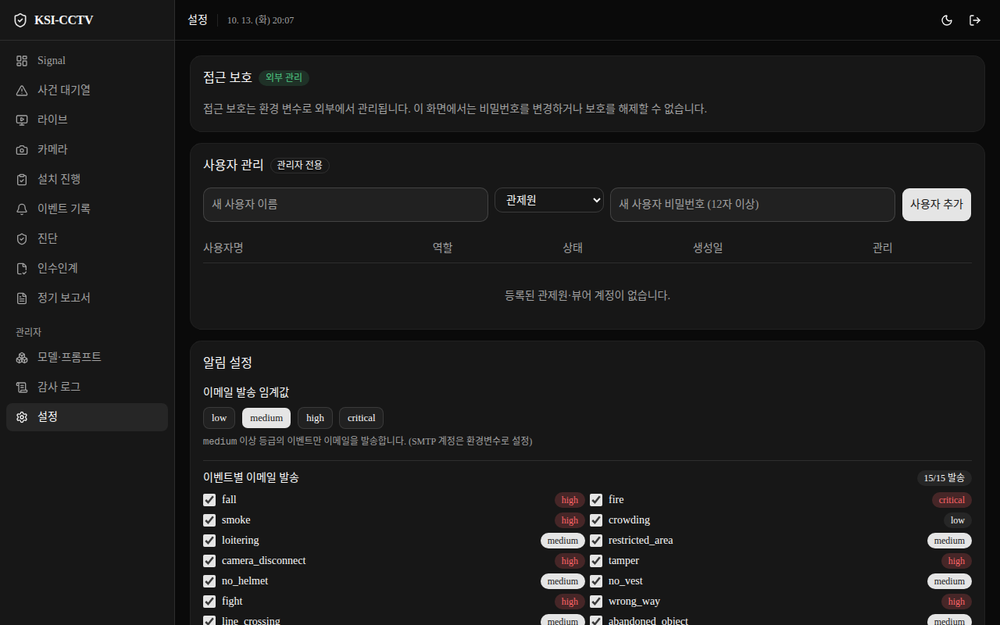
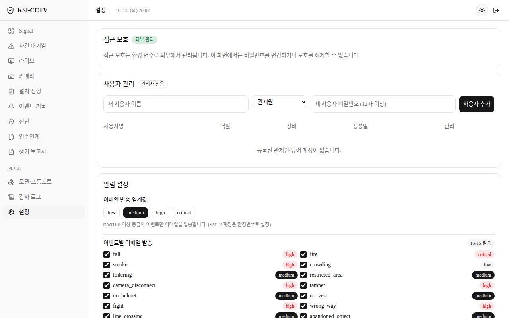
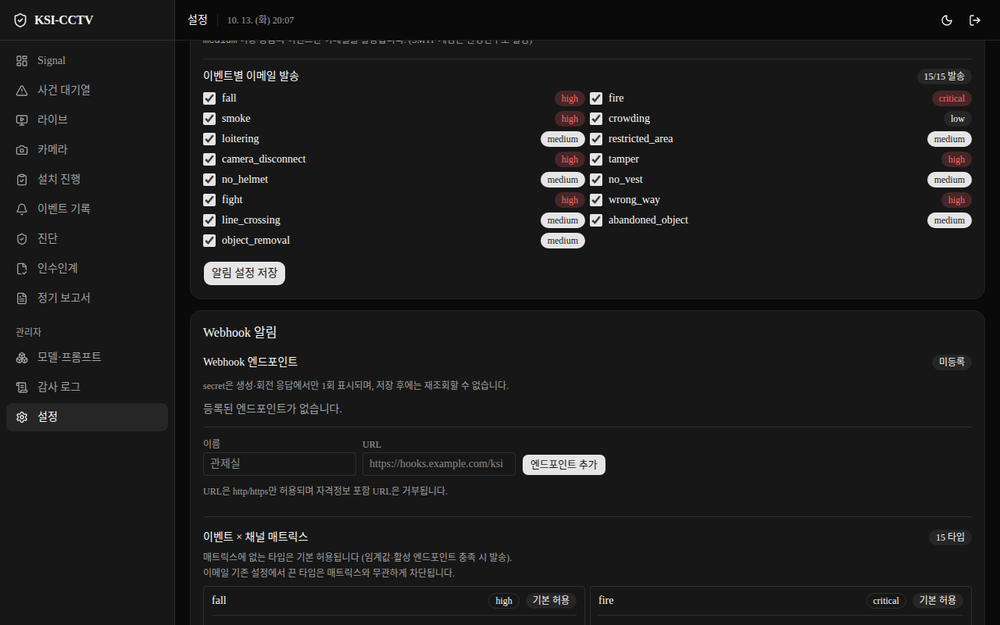
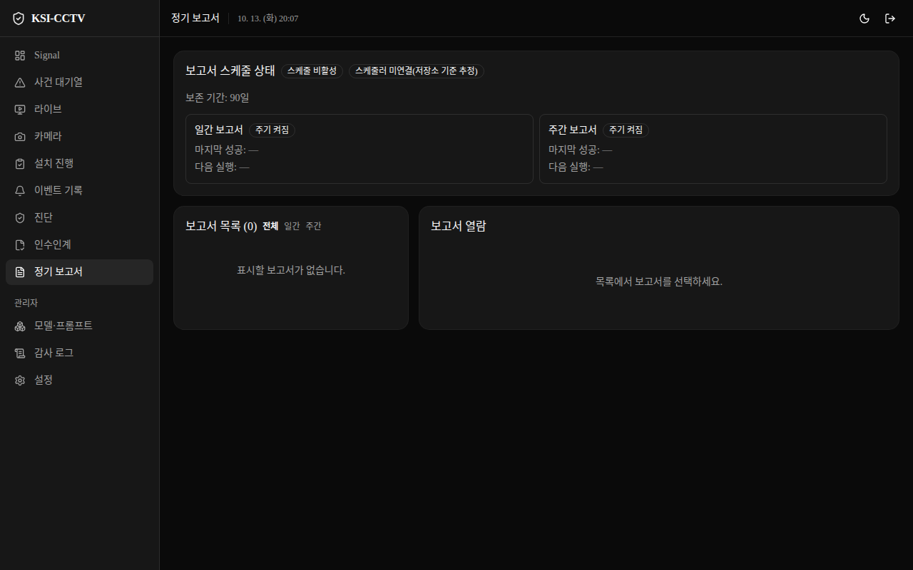
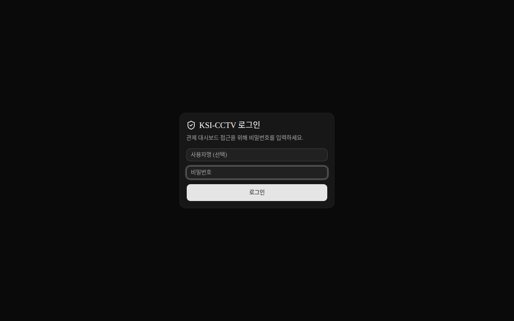
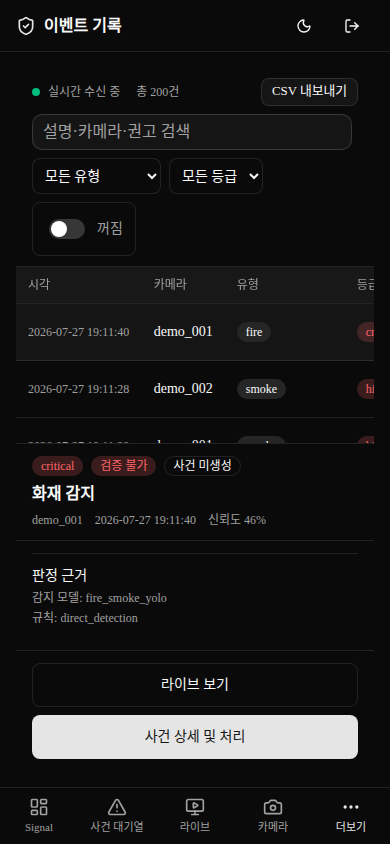
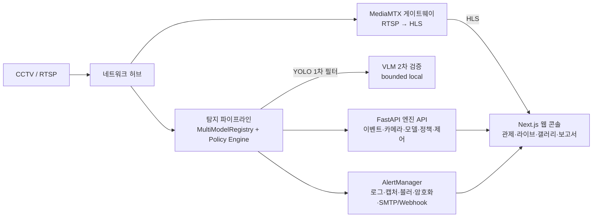

# KSI-CCTV — 현장 맞춤형 지능형 CCTV 안전관리 플랫폼


**카메라마다 감지 목적을 다르게 설정하고, 기본 모델 + 고객 업로드 모델을 조합해 쓰는 커스터마이징 지능형 CCTV 플랫폼입니다.**
건설·학교·공장·주차장 등 현장 특성에 맞춰 안전모 미착용, 화재·연기, 침입·배회, 쓰러짐 의심 등을 감지하고 관제 콘솔로 알립니다.

> 도입 상담: **주식회사 케이에스아이 (KSI Corporation) · 043-288-4860**
> 현장 유형·카메라 대수·감지 항목을 알려주시면 구성 예시를 제안드립니다.

> **English summary:** KSI-CCTV is a configurable AI CCTV safety platform. Per-camera profiles combine multiple YOLO-ONNX models with a YAML policy engine (trigger → rule → VLM → alert), served through a headless FastAPI engine and a Next.js operations console with HLS live video. Offline-appliance oriented, privacy-first (face blur on stored evidence, encrypted captures, audit logs).

[](docs/assets/console-live.png)

*데모 모드 실실행 화면. 영상은 합성 테스트 패턴, 이력 데이터는 데모용이며 실현장 영상·정보는 포함하지 않습니다. 이미지를 클릭하면 원본 크기로 봅니다.*

---

## 왜 KSI-CCTV인가

| 기존 CCTV의 한계 | KSI-CCTV의 답 |
|---|---|
| 모든 카메라에 동일한 감지 적용 | 카메라별 도메인·이벤트·모델 프로파일 (`config/camera_profiles.yaml`) |
| 현장 변경 시 개발자 의존 | YAML 정책 + 웹 콘솔 모델 업로드·활성·프롬프트 관리로 운영자 운용 |
| 잦은 오탐으로 알람 피로 | 지속시간·횟수·구역 규칙(temporal rule) + VLM(2차 영상판독 모델) 검증, 실패 시 `unverified`(미확인)로 보존 — 조용한 누락 금지 |
| 개인정보·보안 우려 | 저장 증거 이미지 얼굴 블러·암호화(Fernet), 감사 로그, 시크릿 마스킹 (실시간 HLS 관제 영상은 원본이며 프록시가 `no-store`로 전달) |

---

## 주요 화면 (데모 모드 실실행 캡처)

| 라이브 관제 | 이벤트 기록 |
|---|---|
| [](docs/assets/console-live.png) | [](docs/assets/console-events.png) |
| HLS 실시간 영상·텔레메트리(FPS)·카메라 상태 | 실시간 수신(SSE)·등급 필터·판정 근거(모델·규칙)·CSV 내보내기 |

| 관제 Signal | 설정 (다크) |
|---|---|
| [](docs/assets/console-signal.png) | [](docs/assets/console-settings-dark.png) |
| 사건 대기열·운영 상태·빈 상태 안내 | 접근 보호·사용자 관리·알림 임계값·이벤트별 발송 설정 |

| 설정 (라이트) | Webhook·매트릭스 |
|---|---|
| [](docs/assets/console-settings-light.png) | [](docs/assets/console-webhook.png) |
| 다크·라이트 테마 지원 | Webhook 엔드포인트(HMAC secret 1회 표시) + 이벤트 × 채널 매트릭스 |

| 정기보고서 | 로그인 |
|---|---|
| [](docs/assets/console-reports.png) | [](docs/assets/console-login.png) |
| 스케줄 상태·보존기간·목록·열람 (미설정 시 빈 상태) | 비밀번호 보호, 세션 만료, 감사 기록 |

### 모바일 (390px)

[](docs/assets/console-events-mobile.png)

*하단 탭 내비게이션의 반응형 뷰어. 별도 네이티브 앱 없이 모바일 관제를 지원합니다.*

---

## 핵심 역량 5가지

1. **카메라별 프로파일** — 건설/학교/공장/주차장/창고/범용 도메인마다 감지 목적·모델·임계값을 개별 설정. (`config/camera_profiles.yaml`, `config/event_policies.yaml:154-709`)
2. **다중 모델 아키텍처** — `general_yolo` + `ppe_yolo` + `fire_smoke_yolo` ONNX를 동시 로드. 메타데이터 기반 클래스 자동 인식, 모델 로드 실패 격리. (`src/detection/`)
3. **이벤트 정책 엔진** — trigger → rule(지속·구역·인원수) → VLM → alert 4단계 YAML 평가. 화재는 2프레임/1초 지속, 연기는 3초 지속 등 오탐 억제 규칙 내장. (`src/policy/`)
4. **운영자 확장성** — ONNX 업로드·검증·격리·활성화, 프롬프트 관리, 파이프라인 제어, 카메라 온보딩 wizard, 정기 보고서·인수인계서. (`frontend/`, `src/reports/`)
5. **보안·프라이버시 기본값** — 저장 증거·스냅샷 얼굴 블러(검출기·키 없으면 시작 실패로 조용한 강등 방지), 선택적 이미지 암호화, scrypt + rate limit + 세션 만료, 감사 로그, API 키 fail-closed 인증. (`src/alerts/`, `docs/architecture.md:62-64`)

감지 이벤트: 화재·연기·안전모/조끼 미착용·쓰러짐 의심·싸움 의심·제한구역 침입·배회·혼잡·지정선 통과·카메라 단절/복구·조작 의심 등 (상태별 active/experimental/planned 구분, `config/event_policies.yaml:17-152`).

---

## 기능 범위 안내

| 구분 | 내용 |
|---|---|
| 출고 기준에 포함된 동작 | COCO/PPE/화재·연기 정책 탐지, ByteTrack `line_crossing`/`loitering`, Next.js 단일 콘솔, HLS 게이트웨이, Webhook 알림, 감사 로그 |
| 콘솔에 구현됨 (출고 범위 협의) | 다중관리자(관리자·관제원·뷰어), 정기 일/주 보고서·Markdown 다운로드 — v1 출고 승인 범위는 `docs/release-gate.md` 기준으로 협의·확정 |
| 개발 중 | pose + ST-GCN fall/fight, bounded local VLM verification (실패는 `unverified`로 보존, silent suppression 금지) |
| 현장 검증 필요 | ARM64 CUDA 실증, 실제 RTSP/HLS·복구 E2E, 동시 채널 soak (동시 채널 수는 검증 후 확정 — 숫자로 증명되지 않은 처리 채널 수·정확도는 표기하지 않음), 모델 라이선스·현장 정확도 |

> 납품 시 `docs/release-gate.md` 기준 release record로 확정합니다.

---

## 시스템 아키텍처



- **운영 배포 대상**: 오프라인 Appliance (서명 미디어 + Caddy HTTPS, 엔진·게이트웨이는 내부망). 일반 `docker compose`·`run_web.sh`는 개발/랩용입니다.
- **영상**: 1차 릴리스는 **HLS only** (WebRTC는 qualification 후속 범위).
- **콘솔**: 데스크톱 관제 + 모바일 뷰어, 다크·라이트, SSE 실시간 이벤트.

---

## 기술 스택

| 영역 | 스택 |
|---|---|
| AI 추론 | YOLO-ONNX (`onnxruntime==1.28.0`, `ultralytics==8.3.111`), ByteTrack 트래킹, pose 휴리스틱 + ST-GCN 경로(개발 중) |
| 2차 검증 | Ollama Qwen3-VL 계열 bounded local VLM (실패 시 `unverified` 보존) |
| 엔진 | Python 3.10, FastAPI `0.139.2` + uvicorn, SSE, SQLite durable store |
| 웹 콘솔 | Next.js `16.3.5`, React `19.2.4`, Tailwind `4`, hls.js `1.6.16`, Playwright E2E |
| 영상 | MediaMTX `1.19.1` (RTSP→HLS 재발행, same-origin 프록시 재생) |
| 배포 | Docker Compose, systemd, 서명 오프라인 번들 |

---

## 빠른 시작 (개발/랩)

```bash
bash scripts/install.sh
cp .env.example .env   # KSI_CCTV_API_KEY, CCTV_CAM_001_URL 설정
set -a; source .env; set +a   # run_web.sh·엔진은 프로세스 환경변수를 사용 (.env 자동 로드 없음)
KSI_CCTV_DEMO=1 bash scripts/run_web.sh   # http://127.0.0.1:3100
```

- 전용 포트: 웹 `3100` · 엔진 `8181` · HLS `8910` / RTSP `8954` (env로 override).
- 데모 모드는 합성 파이프라인·이벤트로 콘솔을 채우고, 랩에 `data/sample.mp4`가 있으면 `cam_001` 라이브로 송출합니다.
- RTSP 계정·비밀번호는 커밋 금지 — `.env` 또는 현장 보안저장소 사용.
- 운영 설치는 `docs/offline-appliance.md` (doctor → 서명검증 → activation health → site CA) 절차만 사용.
- Docker Compose로 띄울 때는 프로젝트 루트 `.env`가 자동 적용됩니다 (compose 변수 치환).

<details>
<summary>개발자용 상세 (클릭)</summary>

- 탐지 데몬: `./.venv/bin/python src/run.py` (파이프라인 + 엔진 API)
- 헬스: `./.venv/bin/python scripts/healthcheck.py --json` → `/health`, `/healthz`, `/health/live`, `/health/ready`
- 게이트: `python3 -B -m pytest tests/ -p no:cacheprovider`, `cd frontend && npm run build`
- 릴리스 후보: `bash scripts/verify_release_candidate.sh --strict` (`docs/internal-ci.md`)
- 설정: `config/default.yaml` · `config/cameras.json` · `config/model_profiles.yaml` · `config/event_policies.yaml` · `config/camera_profiles.yaml`

</details>

---

## 프로젝트 구조

```
src/capture/    RTSP 캡처 (재연결, FPS 이동평균)
src/detection/  MultiModelRegistry, YOLO ONNX, 클래스 어댑터
src/policy/     EventPolicyEngine, RuleEvaluator
src/pipeline/   SafetyPipeline (policy-mode / legacy)
src/vlm/        VLM inference, PromptSelector, TTL cache
src/alerts/     로그·캡처·블러·암호화·SMTP/Webhook
src/api/        FastAPI 엔진 API (읽기/쓰기/제어 + 헬스)
src/reports/    정기 보고서 집계·스케줄·저장소
frontend/       Next.js 웹 콘솔 (관제·라이브·이벤트·보고서)
config/         YAML 정책·프로파일·mediamtx.yml
scripts/        설치·헬스체크·E2E·모델 다운로드/학습
tests/          유닛/통합/contract 테스트
docs/assets/    포트폴리오용 공개 스크린샷 (데모 실실행 캡처)
```

---

## 문서 맵

**발주·담당자용**

| 문서 | 내용 |
|---|---|
| `docs/project-definition.md` | 제품 비전·카메라별 프로파일 원칙 |
| `docs/delivery-checklist.md` | 납품·시연 체크리스트 |
| `docs/installer-camera-onboarding.md` | ONVIF/수동 등록·현장 인수 절차 |
| `docs/offline-appliance.md` | 오프라인 Appliance 설치·업그레이드·롤백 |

**개발·운영용**: `docs/configuration.md` · `docs/operations.md` · `docs/troubleshooting.md` · `docs/deployment-guide.md` · `docs/model-sourcing.md` · `docs/event-policy-engine.md` · `docs/release-gate.md` · `docs/internal-ci.md`

---

## 도입 효과·적용 구성 예시

> 아래는 발주 담당자의 이해를 돕기 위한 **대표 구성 예시(데모 기준)** 입니다. 동시 채널 수는 현장 soak 검증 후 확정합니다.

| 현장 유형 | 카메라 구성 예시 | 감지 구성 예시 |
|---|---|---|
| 건설 현장 | 출입구·타워크레인 하부·중장비 동선 등 | 안전모·조끼 미착용, 화재·연기, 제한구역 침입, 쓰러짐 의심 |
| 학교 | 정문·운동장·복도 | 배회·혼잡, 쓰러짐 의심, 지정선 통과 |
| 공장·물류창고 | 라인·적재장·외곽 | 안전모 미착용, 화재·연기, 제한구역 침입, 카메라 단절 감시 |
| 주차장·빌딩 | 출입구·지하층 | 쓰러짐 의심, 화재·연기, 지정선 통과 |

- **관리자는**: 실시간 관제 → 이벤트 확인 → 캡처 검증 → 정기보고서 다운로드를 하나의 웹 콘솔에서 처리합니다.
- **현장은**: 기존 모델·정책 조합으로 가능한 현장은 콘솔·YAML 설정만으로 확장됩니다.

---

## 기업 역량·문의

- **수행**: **주식회사 케이에스아이 (KSI Corporation)** / KhakiSketch — 오프라인 AI 어플라이언스, 현장 맞춤형 안전관제 구축
- **제공 범위**: 요구수집 → 현장 프로파일 설계 → 모델 큐레이션·정책 튜닝 → 설치·인수·운영 교육
- **대표 연락처**: **043-288-4860** (상담 시 현장 유형·카메라 대수·감지 항목을 알려주시면 구성 예시를 제안드립니다)
- **문의 시 유의**: 현장 영상·계정 등 민감정보는 보내지 마세요. 공개 데모 화면 기준으로 상담합니다.

---

## License

애플리케이션 코드는 `LICENSE` (MIT) 조건으로 제공됩니다. 제3자 모델 가중치·컨테이너 구성요소에는 각 원저작자 라이선스가 적용됩니다.
Ultralytics YOLO 계열 공개 가중치는 AGPL-3.0 파생물로 해석될 수 있어, 폐쇄형 상용 납품 전 `docs/model-sourcing.md`의 라이선스 검토(공개 vs Enterprise) 확정이 필요합니다.
